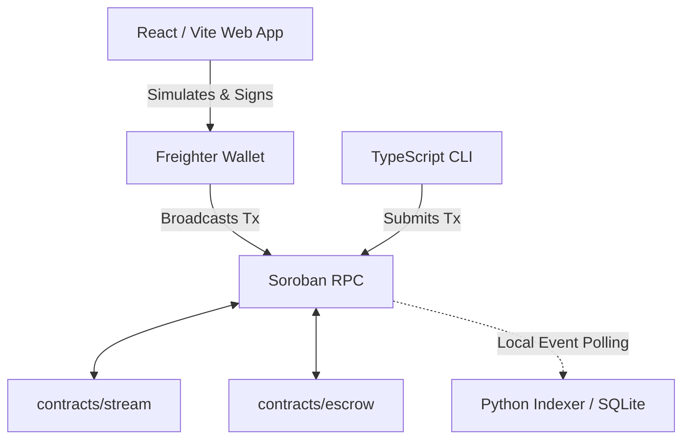

# OrbitStream 🪐

Continuous, non-custodial token streaming protocol built on the Stellar network using Soroban.

[](https://github.com/Space-Stellar/Orbitstream/actions/workflows/soroban.yml)
[](LICENSE)

**Live Dashboard:** [orbitstream-bice.vercel.app](https://orbitstream-bice.vercel.app/)

---

## What It Does

OrbitStream provides continuous per-second token streaming between accounts on the Stellar network. Senders initialize a payment stream to stream tokens over time without manual recurring transactions. Receivers claim accrued tokens lazily based on elapsed ledger time, while senders can cancel streams to settle outstanding balances immediately. Open-source maintainers often lack recurring, automatic funding without relying on manual transfers. Stellar fits this use case through its SEP-41 token interface, low per-transaction cost, and allowance and transfer_from support.

---

## Project Status & Trust Assumptions

> [!WARNING]
> **Testnet Alpha — Unaudited Software:** OrbitStream smart contracts are currently in alpha on Stellar Testnet and have not undergone a formal third-party security audit. Do not use this software with mainnet funds or production assets.

### Trust Assumptions
* **Allowance-Pull Stream Model (`contracts/stream`):** Receivers depend on senders to maintain sufficient token balances and valid token allowances. If a sender drains their balance or revokes their allowance, claims will fail.
* **Escrow Vault Model (`contracts/escrow`):** The escrow contract has no admin or upgrade functions in the current code. It is unaudited. Settlement depends on the token contract accepting transfers (issuers of some assets can freeze or claw back balances).
* **Consensus Timestamps:** Accrual calculations depend on `env.ledger().timestamp()` produced by Stellar network consensus validators.

---

## Architecture



* **Smart Contracts (`contracts/`):** `#![no_std]` Soroban contracts compiled to Wasm:
  * `contracts/stream`: Allowance-pull streaming engine with $O(1)$ state lookups and event emissions.
  * `contracts/escrow`: Escrow vault model requiring upfront deposits with multi-party cancellation and partial withdrawal capabilities.
* **Web Frontend (`web/`):** React 18 + Vite dashboard interacting with Soroban RPC and Freighter wallet. Reads state directly on-chain via simulation; does not depend on an indexing backend.
* **Developer CLI (`cli/`):** TypeScript command-line utility for managing streams, allowances, and queries using `@stellar/stellar-sdk`.
* **Off-Chain Indexer (`indexer/`):** Local-only development utility written in Python (`aiohttp` + `SQLAlchemy` + `aiosqlite`) that polls Soroban RPC events. Currently a stub: it records init events with placeholder values and ignores claim and cancel (tracked as planned issues). **Note:** The indexer is not deployed to cloud infrastructure.

---

## Design Decisions & Tradeoffs

OrbitStream supports two distinct streaming models in the codebase:

### 1. Allowance-Pull Model (`contracts/stream`)
* **Mechanism:** Senders grant a Soroban token allowance to the stream contract and call `init()`. Tokens remain inside the sender's account until `claim()` or `cancel_stream()` pulls accrued funds via `token_client.transfer(&sender, &receiver, ...)`.
* **Advantages:** High capital efficiency; senders retain custody and utility of unaccrued tokens.
* **Tradeoffs & Risks:**
  * **Phantom Balance:** The web dashboard and contracts compute theoretical accruals from timestamps. If the sender's token balance or allowance drops below the accrued total, claims will fail with token contract transfer errors.
  * **Trapped Cancellation:** If a sender has accrued obligations but zero balance or allowance, `cancel_stream()` reverts on the settlement transfer, leaving the stream open in persistent storage.

### 2. Escrow Vault Model (`contracts/escrow`)
* **Mechanism:** Senders deposit the full streaming capital upfront into the escrow contract via `deposit()`. Tokens are held directly in contract reserves.
* **Advantages:** Funds are held by the contract, so receivers do not depend on the sender's wallet balance. Either party (`sender` or `receiver`) can trigger `cancel_stream()`. Senders may call `withdraw()` to retrieve unaccrued funds anytime.
* **Tradeoffs:** Requires 100% upfront capital commitment by the sender.

### State ordering
State is updated before the external token transfer in claim and cancel_stream. This is a defensive pattern; Soroban already reverts all changes if the transfer fails.
* In `contracts/stream`: `config.withdrawn` is incremented and written to persistent storage *before* calling external token contract transfer functions. In `cancel_stream`, the storage key is removed *before* settlement.
* In `contracts/escrow`: Storage state is mutated or removed *before* contract reserves are transferred to callers.

### Token Denomination
All `flow_rate` and token balance parameters are denominated in atomic units (stroops, where 1 XLM = 10,000,000 stroops).

---

## Deployed Contracts (Testnet)

| Contract | Network | Contract ID | Explorer Link |
| :--- | :--- | :--- | :--- |
| **Stream Contract** | Testnet | `CAESALD2PIFE636E4C4DDJTOFQBBLOB3GK35WK6SY3IL2WNKUWHGAG6Y` | [View on Stellar.Expert](https://stellar.expert/explorer/testnet/contract/CAESALD2PIFE636E4C4DDJTOFQBBLOB3GK35WK6SY3IL2WNKUWHGAG6Y) |
| **Native Token (XLM)** | Testnet | `CDLZFC3SYJYDZT7K67VZ75HPJVIEUVNIXF47ZG2FB2RMQQVU2HHGCYSC` | [View on Stellar.Expert](https://stellar.expert/explorer/testnet/contract/CDLZFC3SYJYDZT7K67VZ75HPJVIEUVNIXF47ZG2FB2RMQQVU2HHGCYSC) |
| **Escrow Vault** | Testnet | *Not deployed (Local development only)* | — |

Detailed smart contract interfaces, parameter types, error codes, and events are documented in [docs/CONTRACTS.md](docs/CONTRACTS.md).

---

## Quick Start

### 1. Build and Test Smart Contracts

Prerequisites: Rust stable and `wasm32-unknown-unknown` target.

```bash
# Run tests across all workspace contracts
cargo test --workspace

# Check formatting and linting
cargo fmt --all -- --check
cargo clippy --workspace --all-targets -- -D warnings

# Build release Wasm artifacts
cargo build --target wasm32-unknown-unknown --profile release
```

### 2. Run the Developer CLI

Prerequisites: Node.js 20+. Configure `STREAM_CONTRACT_ID` and `SOROBAN_SECRET_KEY` in root `.env`.

```bash
cd cli
npm install
npm run build

# Display available commands
node dist/index.js --help

# Approve stream contract allowance (example: native XLM)
node dist/index.js approve --token CDLZFC3SYJYDZT7K67VZ75HPJVIEUVNIXF47ZG2FB2RMQQVU2HHGCYSC --amount 10000000

# Initialize a new stream
node dist/index.js init --receiver <MAINTAINER_ADDRESS> --token CDLZFC3SYJYDZT7K67VZ75HPJVIEUVNIXF47ZG2FB2RMQQVU2HHGCYSC --flow-rate 100

# Query active stream details
node dist/index.js get --sender <SENDER_ADDRESS> --receiver <MAINTAINER_ADDRESS>

# Claim accrued tokens (run as receiver)
node dist/index.js claim --sender <SENDER_ADDRESS> --receiver <YOUR_ADDRESS>
```

### 3. Run the Frontend Dashboard

Prerequisites: Node.js 20+ and Freighter browser extension configured for Testnet.

```bash
cd web
npm install
npm run dev
```

Visit `http://localhost:5173` to test wallet connection and live stream monitoring.

### 4. Run the Local Event Indexer

Prerequisites: Python 3.10+.

```bash
cd indexer
python3 -m venv venv
source venv/bin/activate
pip install -r requirements.txt
python main.py
```

---

## Roadmap & Stream Splitting

Logic for multi-receiver stream fan-out splitting is tracked on the experimental branch [`wip/split-fanout`](https://github.com/Space-Stellar/Orbitstream/tree/wip/split-fanout).

---

## Contributing

Contributions are welcome. Please read [CONTRIBUTING.md](CONTRIBUTING.md) for local development workflows, branch naming guidelines, and pull request procedures.

---

## Security

Please report vulnerabilities following the procedures in [SECURITY.md](SECURITY.md).

---

## Maintainers

| Name | Role | Contact |
| :--- | :--- | :--- |
| webdevayo | Core Maintainer | [@dev_ayo](https://t.me/dev_ayo) |

Community Chat: [<FILL_ME: community link>](<FILL_ME: telegram/discord link>)

---

## Contributors

<a href="https://github.com/Space-Stellar/Orbitstream/graphs/contributors">
  
</a>
